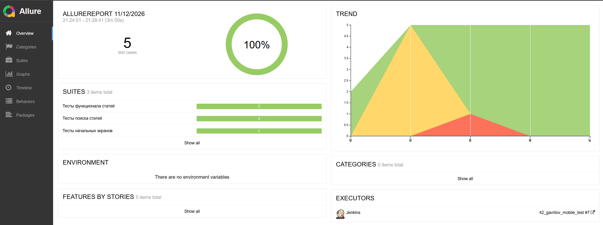
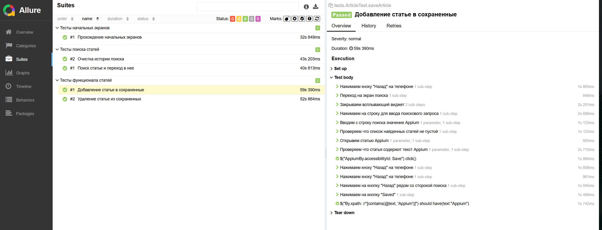

# Mobile UI Tests

Автоматизированные UI-тесты Android-приложения **Wikipedia**.

## Стек технологий

| Технология | Назначение |
|---|---|
| Java | Язык тестов |
| Gradle | Сборка и зависимости |
| JUnit 5 | Тестовый фреймворк |
| Selenide 6.13.0 | UI-автоматизация |
| Appium Java Client 8.3.0 | Управление Android-приложением |
| UiAutomator2 | Автоматизация Android |
| Allure 2.21.0 | Отчёты и вложения |
| Owner 1.0.4 | Чтение конфигурации |
| REST Assured 5.3.0 | Запрос ссылки на видео BrowserStack API |
| AspectJ Weaver 1.9.22 | Поддержка Allure-аспектов |
| SLF4J 2.0.7 | Логирование |

## Что проверяют тесты

В проекте реализовано **5 тестовых методов**.

| Тестовый класс | Сценарии |
|---|---|
| `OnBoardingScreenTests` | Прохождение стартовых экранов и проверка главного экрана |
| `SearchTests` | Поиск статьи и переход к ней; очистка истории поиска |
| `ArticleTest` | Добавление статьи в сохранённые; удаление статьи из сохранённых |

Тестовая статья по умолчанию — `Appium`. Значение задаётся в `src/test/resources/configurations/testdata/TestData.properties`.

## Структура проекта

```text
mobile_test/
├── build.gradle
├── settings.gradle
└── src/test/
    ├── java/
    │   ├── config/
    │   ├── drivers/
    │   ├── helpers/
    │   ├── screens/
    │   │   └── components/
    │   ├── testdata/
    │   └── tests/
    └── resources/
        └── configurations/
            ├── drivers/
            └── testdata/
```


## Описание Java-классов

### `config`

| Класс | Назначение |
|---|---|
| `BrowserstackConfig` | Описывает endpoint, учётные данные, проект, сборку, устройство, ОС, Appium и приложение BrowserStack |
| `LocalConfig` | Описывает параметры локального Android-устройства, package и activity приложения |
| `TestDataConfig` | Предоставляет тестовые данные из properties; для `articleName` задано пустое значение по умолчанию |
| `ConfigProvider` | Создаёт и хранит экземпляры конфигураций BrowserStack, локального устройства и тестовых данных |

### `drivers`

| Класс | Назначение |
|---|---|
| `DriverFactory` | Выбирает драйвер по системному параметру `deviceHost`: `browserstack` или локальный |
| `LocalDriver` | Создаёт `AndroidDriver` с UiAutomator2, читает параметры локального устройства и при необходимости загружает APK Wikipedia Alpha |
| `BrowserstackDriver` | Создаёт `AndroidDriver` для BrowserStack и передаёт параметры сессии через `bstack:options` |

### `helpers`

| Класс | Назначение |
|---|---|
| `Attach` | Формирует Allure-вложения: page source, скриншот и HTML-страницу с видео BrowserStack |
| `Browserstack` | Через REST API BrowserStack получает URL видео по ID автоматизационной сессии |

### `screens`

| Класс | Назначение |
|---|---|
| `OnBoardScreen` | Взаимодействует с начальными экранами приложения и позволяет пройти onboarding |
| `HomeScreen` | Проверяет открытие главного экрана и переходит к поиску |
| `SearchScreen` | Выполняет поиск, проверяет результаты, открывает статью, очищает историю и переходит к сохранённым статьям |
| `ArticleScreen` | Проверяет текст статьи, нажимает кнопку сохранения и использует системную кнопку «Назад» |
| `SavedArticlesScreen` | Проверяет наличие или отсутствие статьи в сохранённых и открывает её |

### `screens.components`

| Класс | Назначение |
|---|---|
| `ConfirmWindow` | Подтверждает очистку истории поиска нажатием кнопки `Yes` |

### `testdata`

| Класс | Назначение |
|---|---|
| `TestData` | Предоставляет название статьи из `TestDataConfig` и текст сообщения о пустой истории поиска |

### `tests`

| Класс | Назначение |
|---|---|
| `TestBase` | Настраивает Selenide, выбирает драйвер, инициализирует Page Object-классы и добавляет вложения Allure после тестов |
| `OnBoardingScreenTests` | Проверяет прохождение onboarding и открытие главного экрана |
| `SearchTests` | Проверяет поиск и открытие статьи, а также очистку истории поиска |
| `ArticleTest` | Проверяет добавление статьи в сохранённые и её удаление |

### Назначение пакетов

- `config` — интерфейсы конфигурации и единая точка доступа к ним.
- `drivers` — создание Appium-драйвера для локального устройства или BrowserStack.
- `helpers` — вспомогательные методы, включая Allure-вложения и получение видео BrowserStack.
- `screens` — Page Object-классы экранов приложения.
- `screens.components` — переиспользуемые компоненты интерфейса.
- `testdata` — тестовые данные.
- `tests` — тестовые сценарии и базовая настройка тестов.

## Локальный запуск

1. Запустите Android-эмулятор и Appium Server.
2. Проверьте параметры в `src/test/resources/configurations/drivers/LocalConfig.properties`.
3. Запустите тесты из корня проекта:

```bash
gradle clean test -DdeviceHost=emulation
```

Текущие параметры локального устройства:
- `deviceName=Medium Phone API 37.0`
- `osVersion=17.0`
- `appPackage=org.wikipedia.alpha`
- `appActivity=org.wikipedia.main.MainActivity`
- Appium endpoint: `http://localhost:4723/wd/hub`

При первом запуске `LocalDriver` скачивает APK Wikipedia Alpha в `src/test/resources/apps/`, если файла там ещё нет. Если параметры эмулятора отличаются, обновите `LocalConfig.properties`.

## Запуск в BrowserStack

Проект поддерживает BrowserStack App Automate. Настройки находятся в `src/test/resources/configurations/drivers/BrowserstackConfig.properties`.

| Параметр | Назначение |
|---|---|
| `baseUrl` | Appium endpoint BrowserStack |
| `userName`, `accessKey` | Учётные данные BrowserStack |
| `projectName`, `buildName`, `sessionName` | Названия проекта, сборки и сессии |
| `deviceName`, `osVersion` | Модель устройства и версия Android |
| `appiumVersion` | Версия Appium |
| `platformName` | Платформа |
| `app` | ID загруженного приложения BrowserStack (`bs://...`) |

Укажите собственные действующие учётные данные и ID приложения, затем выполните:

```bash
gradle clean test -DdeviceHost=browserstack
```

`DriverFactory` выберет `BrowserstackDriver`. После завершения теста проект получает ID сессии, запрашивает у BrowserStack ссылку на видеозапись и прикладывает HTML-вложение к результатам Allure.


## Конфигурация и тестовые данные

Конфигурация читается библиотекой Owner. `ConfigProvider` создаёт экземпляры интерфейсов конфигурации; системные свойства Java передаются в `ConfigFactory` и могут переопределять значения properties.

| Файл | Содержание |
|---|---|
| `configurations/drivers/LocalConfig.properties` | Параметры локального Android-устройства и приложения |
| `configurations/drivers/BrowserstackConfig.properties` | Настройки BrowserStack и параметры устройства |
| `configurations/testdata/TestData.properties` | Тестовые данные, включая название статьи |

Тестовую статью можно переопределить системным свойством:

```bash
gradle test -DdeviceHost=emulation -DarticleName="Selenium"
```

## Allure-отчётность

В `TestBase` подключается listener `AllureSelenide`.

- При локальном запуске к результатам прикладываются скриншот и page source.
- При запуске в BrowserStack проект получает ID сессии и добавляет HTML-вложение с видеозаписью, если BrowserStack вернул URL видео.

Создать отчёт:

```bash
gradle allureReport
```

Открыть отчёт локально:

```bash
gradle allureServe
```





## Примечания

- Тесты предназначены для Wikipedia Alpha (`org.wikipedia.alpha`).
- Локальный APK загружается из GitHub Releases проекта Wikimedia при отсутствии файла в `src/test/resources/apps/`.
- Для BrowserStack используется загруженное в BrowserStack приложение с ID формата `bs://...`; при необходимости укажите актуальный ID из своего аккаунта.
- REST Assured используется для обращения к BrowserStack API; отдельного набора API-тестов в проекте нет.
